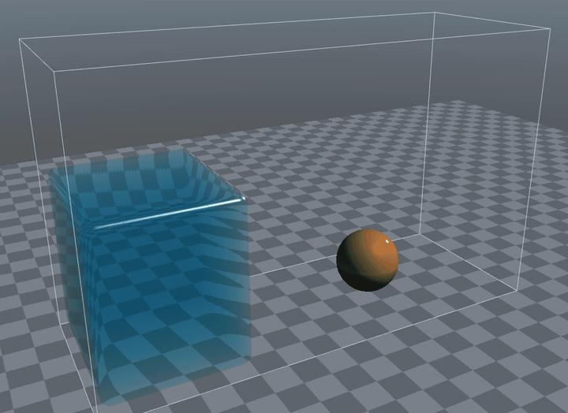
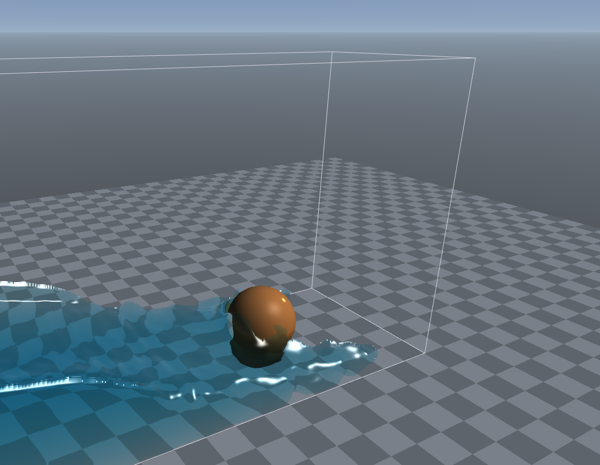
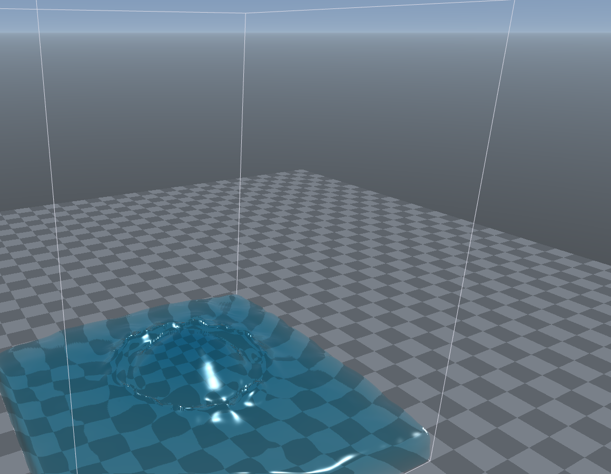
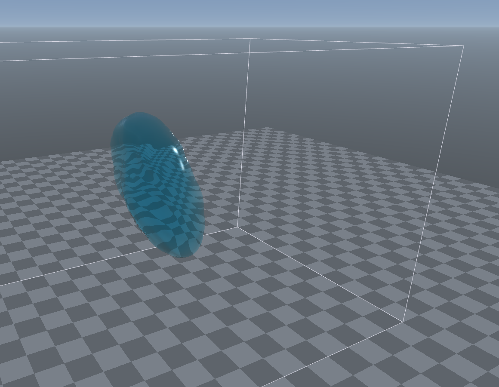
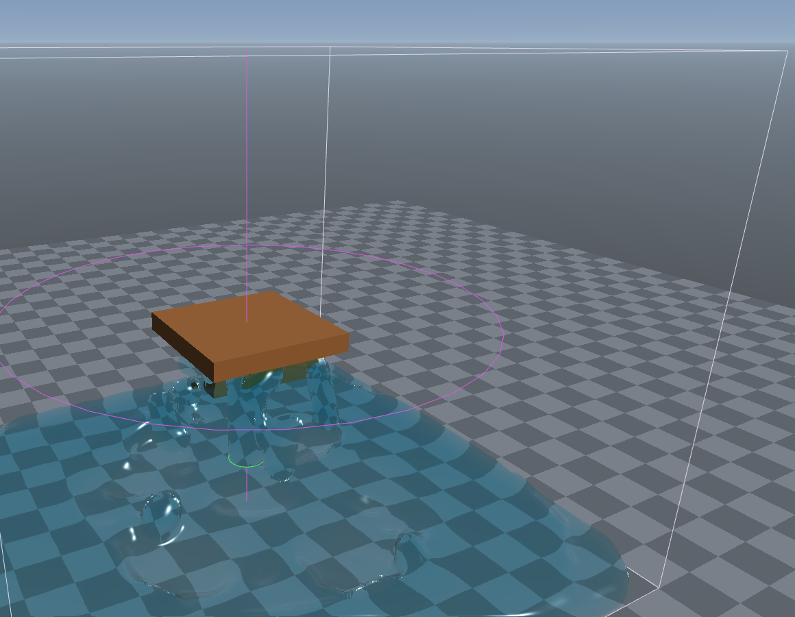

# tinysph

[](https://github.com/varnholt/tinysph/actions/workflows/ci.yml)

A tiny C++23 library for smoothed particle hydrodynamics (SPH): fluid volumes, colliders, force fields and emitters
behind one small API, with no dependencies beyond the standard library. Comes with an interactive sandbox that renders
the fluid as a surface with reflection and refraction, and lets you poke the water with the mouse.



**[Try the sandbox in your browser](https://varnholt.github.io/tinysph/)**: a reduced demo. It runs on one CPU
thread in WebAssembly, with about 1,400 particles; the native build runs on all cores or the GPU and handles 10x-100x
more. **[The WebGPU sandbox](https://varnholt.github.io/tinysph/webgpu/)** is the [Rust port](rust/README.md#sandbox)
running the GPU solver in the browser, with about 9,600 particles in the dam break.

| | |
|---|---|
|  |  |
| dam break against a sphere | a drop falling into a pool |
|  |  |
| two drops merging in zero gravity (surface tension) | fountain hitting a plate, with a vortex |

The images come straight from the sandbox, e.g. `tinysph_sandbox --preset 3 --zoom 4`. The animation is
`tinysph_sandbox --gpu --capture <directory> --frames 150`, which writes every frame without the UI and quits, turned
into a GIF with ffmpeg.

```cpp
#include <tinysph/tinysph.h>
using namespace std::chrono_literals;

tinysph::World world{{._domain = {{0, 0, 0}, {1.6f, 1, 0.6f}}}};
world.addFluid(tinysph::Box{._center = {0.25f, 0.3f, 0.3f}, ._half_extents = {0.23f, 0.28f, 0.28f}});
world.addCollider(tinysph::Sphere{._center = {1.1f, 0.12f, 0.3f}, ._radius = 0.12f});

while (running)
{
   world.step(16ms);           // any std::chrono duration
   draw(world.positions());    // std::span<const tinysph::Vec3>
}
```

Settings that come from user input can be checked instead of trusted:

```cpp
if (auto world = tinysph::World::create(settings))
{
   run(*world);
}
else
{
   std::println("invalid settings: {}", tinysph::describe(world.error()));
}
```

See [examples/hello_fluid.cpp](examples/hello_fluid.cpp) for a complete program.

## Use it in your project

FetchContent:

```cmake
include(FetchContent)
FetchContent_Declare(tinysph GIT_REPOSITORY https://github.com/varnholt/tinysph.git GIT_TAG v0.1.0)
FetchContent_MakeAvailable(tinysph)
target_link_libraries(your_target PRIVATE tinysph::tinysph)
```

When pulled in this way only the library is built; the sandbox, tests and examples are skipped.

Or install it and use `find_package`:

```
cmake -S . -B build -DTINYSPH_BUILD_SANDBOX=OFF
cmake --build build --config Release
cmake --install build --config Release --prefix <prefix>
```

```cmake
find_package(tinysph 0.1 REQUIRED)
target_link_libraries(your_target PRIVATE tinysph::tinysph)
```

## API

Everything public lives in `include/tinysph/`:

| Header | Contents |
|--------|----------|
| `tinysph.h` | includes everything below |
| `world.h` | `World`: the simulation. Particles, colliders, force fields, emitters, `step()` |
| `types.h` | shapes (`Sphere`, `Box`), force fields (`Attractor`, `Vortex`, `Wind`), `Emitter`, handles, `WorldSettings`, `FluidParameters`, `SettingsError`, `StepStatistics`, `Seconds` |
| `math.h` | `Vec3`, `Aabb` |
| `version.h` | `tinysph::version` |

Design rules that keep it stable:

- `World` hides its implementation behind a pointer, so the solver, its data layout and the backend (CPU or GPU) can change without breaking your code.
- Colliders, force fields and emitters are referred to by typed handles (`ColliderId`, ...). A handle never points to a different object after removal; ids are not reused.
- `WorldSettings` is fixed per world (resolution, rest density, backend); `FluidParameters` can be changed at any time.
- Time is a `std::chrono` duration, so `step(16)` (seconds or milliseconds?) does not compile; `step(16ms)` does.
- Invalid settings are reported through `std::expected` by `World::create()`; the constructor throws `std::invalid_argument` (or terminates without exceptions). A GPU world that finds no usable GPU fails with `SettingsError::GpuUnavailable`, or `std::runtime_error` from the constructor.
- Semantic versioning. Until 1.0 the API may still change between minor versions; from 1.0 on, only with a new major version.

## Build

Requirements: CMake 3.25+ and a C++23 compiler. CI builds and tests with MSVC (Visual Studio 2022), GCC 14, Clang 20 and AppleClang (macOS 15).
The sandbox fetches SDL3 and Dear ImGui.

```
cmake -S . -B build -G "Visual Studio 17 2022" -A x64
cmake --build build --config Release
build\sandbox\Release\tinysph_sandbox.exe
```

Tests and benchmark:

```
ctest --test-dir build -C Release --output-on-failure
build\tests\Release\tinysph_bench.exe [--gpu] [speed_of_sound] [viscosity] [seconds] [artificial_viscosity]
```

| Option | Default | |
|--------|---------|-|
| `TINYSPH_BUILD_SANDBOX` | top level only | interactive sandbox |
| `TINYSPH_BUILD_TESTS` | top level only | `tinysph_api_tests`, `tinysph_internal_tests`, `tinysph_bench` |
| `TINYSPH_BUILD_EXAMPLES` | top level only | `hello_fluid` |
| `TINYSPH_INSTALL` | top level only | install rules and the CMake package |
| `TINYSPH_GPU` | `OFF` | GPU backend; downloads a prebuilt [wgpu-native](https://github.com/gfx-rs/wgpu-native) at configure time |

## GPU backend

Build with `-DTINYSPH_GPU=ON` and ask for the backend in the settings:

```cpp
auto world = tinysph::World::create({._backend = tinysph::Backend::Gpu});
if (!world)
{
   // SettingsError::UnsupportedBackend: built without TINYSPH_GPU
   // SettingsError::GpuUnavailable: no usable GPU on this machine
}
std::println("running on {}", world->deviceDescription());
```

Everything else stays the same: the API, the results (within float round-off, the tests compare both backends) and
the particle data you read back. The solver passes run as WebGPU compute shaders through wgpu-native, so the same
code runs on Vulkan, Metal and Direct3D 12. On machines without a GPU it falls back to a software adapter (WARP,
lavapipe). wgpu-native is a shared library: it ships next to your program, and `cmake --install` installs it with
tinysph.

The 2 s dam break benchmark (9614 particles) takes 0.85 s on a laptop RTX PRO 4000, against 5.1 s on the CPU backend
(Core Ultra 9 285HX, 24 threads).

For now `World::step()` uploads the particles, runs all substeps on the GPU and reads them back at the end, so
`positions()` works as before. Between substeps only the maximum speed and acceleration come back, for the
adaptive time step.

In the sandbox, tick "gpu" in the simulation panel or start it with `--gpu`.

## In the browser

The sandbox also builds with Emscripten. CI publishes every push to `main` at
[varnholt.github.io/tinysph](https://varnholt.github.io/tinysph/). The browser runs it on a single thread, so it starts
with coarser particles (0.045 m spacing, about 1400 particles in the dam break); the spacing slider in the "Fluid"
section goes finer. The Rust sandbox, which simulates on the GPU through WebGPU, is published next to it at
[varnholt.github.io/tinysph/webgpu](https://varnholt.github.io/tinysph/webgpu/), see [rust/README.md](rust/README.md#sandbox).

```
emcmake cmake -S . -B build-web -DCMAKE_BUILD_TYPE=Release -DTINYSPH_BUILD_TESTS=OFF -DTINYSPH_BUILD_EXAMPLES=OFF
cmake --build build-web --target tinysph_sandbox
python -m http.server -d build-web/sandbox
```

## Sandbox controls

| Input | Action |
|-------|--------|
| left drag | mouse tool (pull or push the fluid) |
| right drag | orbit |
| middle drag | pan |
| wheel | zoom |
| space | play / pause |
| r | reset the scene |

## Rust

[`rust/`](rust) is a port of the library to Rust, published as the `tinysph` crate: the same API and the same CPU
solver, std only and without `unsafe`. It reproduces this library's CPU results bit for bit, checked in CI against
the reference trace in `tests/data/trace.txt` (written by `tests/trace.cpp`). The optional cargo feature `gpu` adds
the GPU backend on the `wgpu` crate, running the same WGSL shaders. See [rust/README.md](rust/README.md).

## Layout

| Path | Contents |
|------|----------|
| `include/tinysph/` | public API |
| `src/` | implementation (`tinysph::detail`), not installed |
| `src/gpu/` | GPU backend: WGSL compute shaders and the wgpu-native host code |
| `sandbox/` | the interactive sandbox: SDL3 window, OpenGL 3.3 / GLSL ES 3.00 renderer, Dear ImGui panels |
| `examples/` | small programs using the library |
| `tests/` | API tests, internal tests, headless dam break benchmark |
| `rust/` | the Rust crate |
| `docs/` | SPH notes and the gallery images |

## Solver

Weakly compressible SPH (WCSPH) with the Mueller et al. 2003 kernels:

- uniform grid with cell size h, rebuilt every substep with a counting sort that also reorders the particle data
- density with the poly6 kernel, self contribution included
- pressure `p = c^2 (rho - rho0)`, optionally clamped at 0
- symmetric pressure force (spiky gradient), viscosity (viscosity kernel laplacian), Monaghan artificial viscosity
- semi-implicit Euler with an adaptive time step (CFL and force condition)
- colliders as signed distance functions, the domain as six planes

The GPU backend runs the same passes as compute shaders (`src/gpu/shaders.h`). The counting sort becomes an atomic
count per cell, a prefix sum and a scatter. The particle order inside a cell then depends on the order of the
atomics, which is the only difference to the CPU.

## Background

tinysph started as a rewrite of [smoothed_particle_hydrodynamics](https://github.com/varnholt/smoothed_particle_hydrodynamics) (2015/2016).
The theory notes from the original project live in [docs/sph-notes.md](docs/sph-notes.md).

## Code style

Same as deceptus_engine: `_clang-format` and `.cmake-format.yaml` are copied from there.

```
clang-format -i include/tinysph/*.h src/*.h src/*.cpp sandbox/src/*.h sandbox/src/*.cpp tests/*.h tests/*.cpp examples/*.cpp
uv sync
uv run cmake-format -i CMakeLists.txt sandbox/CMakeLists.txt tests/CMakeLists.txt examples/CMakeLists.txt
```

## License

MIT, see [LICENSE](LICENSE).
