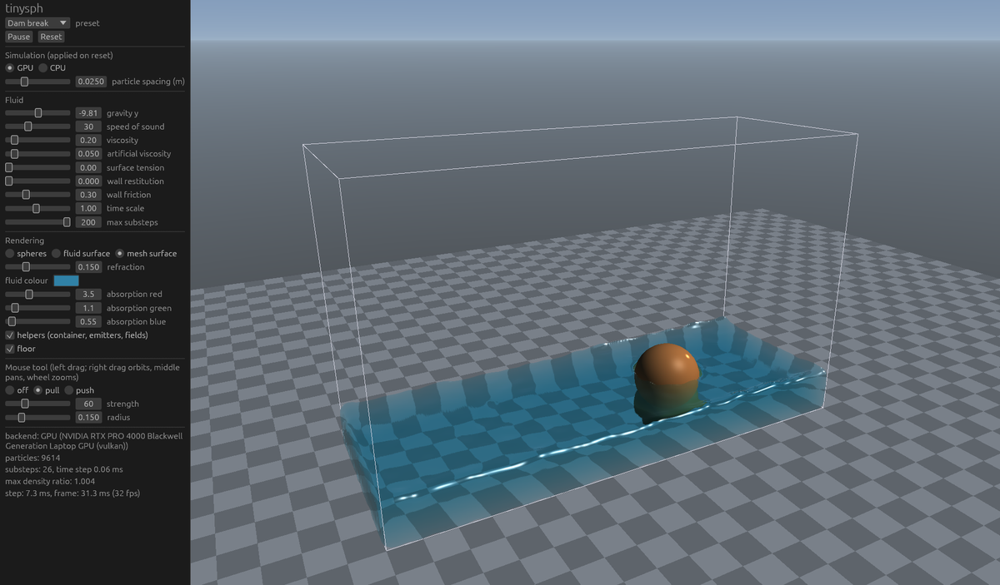

# tinysph for Rust

[](https://github.com/varnholt/tinysph/actions/workflows/ci.yml)

A weakly compressible SPH fluid simulation: particles in a box shaped domain, sphere and box colliders, attractors,
vortices and wind, emitters, surface tension, and an adaptive time step that keeps it stable.

This is the Rust port of the C++23 library [tinysph](https://github.com/varnholt/tinysph). The solver follows the C++
CPU solver operation by operation, and CI holds the two to it: the crate replays the scenes of the C++ reference trace
and compares every recorded frame.

- no dependencies and no `unsafe` (the optional GPU backend adds `wgpu`)
- multithreaded on the CPU with a pool of worker threads that lives as long as the world (std only, no `unsafe`); results do not depend on the thread count
- the same API as the C++ library, with `Result`s instead of exceptions and typed handles that are never reused
- an optional GPU backend (cargo feature `gpu`) on [`wgpu`](https://wgpu.rs), running the WGSL compute shaders of the
  C++ library

## Usage

```toml
[dependencies]
tinysph = "0.1"
```

```rust
use std::time::Duration;
use tinysph::{Aabb, Shape, Vec3, World, WorldSettings};

// a 1.6 x 1.0 x 0.6 m tank
let settings = WorldSettings { domain: Aabb::new(Vec3::ZERO, Vec3::new(1.6, 1.0, 0.6)), ..Default::default() };
let mut world = World::new(settings, Default::default())?;

// a column of water on the left and a ball in its way
world.add_fluid(Shape::cuboid(Vec3::new(0.25, 0.3, 0.3), Vec3::new(0.23, 0.28, 0.28)), Vec3::ZERO);
world.add_collider(Shape::sphere(Vec3::new(1.1, 0.12, 0.3), 0.12));

loop {
    let statistics = world.step(Duration::from_secs(1) / 60);
    draw(world.positions(), world.particle_radius());
}
```

| | |
|---|---|
| `World::new(WorldSettings, FluidParameters)` | creates a world, or returns a `SettingsError` saying why the settings are invalid |
| `World::validate(&WorldSettings)` | checks settings without creating a world |
| `step(Duration)`, `step_with_limit(Duration, max_substeps)`, `step_seconds(f32, max_substeps)` | advance with adaptive substeps (at most 1000 by default) and return `StepStatistics` |
| `add_fluid(Shape, velocity)`, `add_particle`, `clear_particles` | fill a sphere or box at rest spacing, skipping colliders and space outside the domain |
| `positions()`, `velocities()`, `densities()` | particle data as slices; the order changes between steps |
| `particle_count()`, `particle_mass()`, `particle_radius()` | |
| `settings()`, `parameters()`, `set_parameters()`, `domain()`, `set_domain()` | the domain can change at any time, particles outside are pushed back in |
| `add_collider` / `set_collider` / `remove_collider` / `collider` | `Shape::Sphere` and `Shape::Cuboid` (the C++ `Box`), handles are `ColliderId` |
| `add_force_field` / `set_force_field` / `remove_force_field` / `force_field` | `Attractor`, `Vortex`, `Wind`, handles are `ForceFieldId` |
| `add_emitter` / `set_emitter` / `remove_emitter` / `emitter` | disk shaped nozzles that spawn non overlapping layers, handles are `EmitterId` |
| `WorldSettings` | domain, particle spacing, rest density, support radius factor, particle cap, backend; fixed per world |
| `FluidParameters` | gravity, speed of sound, viscosity, artificial viscosity, surface tension, wall restitution and friction, time step limits |
| `StepStatistics` | last `time_step`, `substeps`, `simulated_time`, max and average density ratio, `max_speed`, `wall_time` |

The defaults of `WorldSettings` and `FluidParameters` are those of the C++ library: water at 2.5 cm spacing in a
1 m cube. The solver itself is described in the [main README](https://github.com/varnholt/tinysph#solver).

A `Duration` holds whole nanoseconds, so `Duration::from_secs(1) / 60` is one ulp away from the `f32` the C++
`world.step(1s / 60.0)` uses, and the two runs drift apart after a few hundred substeps. To reproduce C++ runs exactly,
pass the frame time as `f32` seconds: `world.step_seconds(1.0 / 60.0, DEFAULT_MAX_SUBSTEPS)`.

## GPU backend

```toml
[dependencies]
tinysph = { version = "0.1", features = ["gpu"] }
```

```rust
let settings = WorldSettings { backend: Backend::Gpu, ..Default::default() };
let mut world = World::new(settings, Default::default())?; // Err(SettingsError::GpuUnavailable) without a usable gpu
println!("{}", world.device_description()); // e.g. "NVIDIA GeForce RTX 4070 (vulkan)"
```

- `Backend::Gpu` needs the `gpu` feature; without it `World::new` returns `SettingsError::UnsupportedBackend`. With
  it, `World::new` returns `SettingsError::GpuUnavailable` if no adapter is found or the GPU cannot hold the buffers
  for the settings. The feature pulls in `wgpu` and `pollster` and needs Rust 1.87 (the MSRV of `wgpu`).
- Vulkan, Metal or D3D12, a real GPU first and a software adapter (lavapipe, WARP) as the fallback; and WebGPU in a
  browser (`wasm32`, see below). OpenGL is left out on purpose, as in the C++ library: it would make its own context current on the
  calling thread and break applications that render with OpenGL on it. Waiting for the GPU is kept in one small
  module (`blocking` in `src/gpu.rs`).
- A browser cannot block, so on `wasm32` a GPU world is created with `World::new_async` and stepped with
  `World::step_seconds_async`, which await the device and each substep's readback (`World::new` returns
  `GpuUnavailable` there). Both are available natively too, where they never suspend and give the same results as
  `new` and `step_seconds`. `StepStatistics::wall_time` is zero on `wasm32`, which has no clock without JavaScript.
- It works like the C++ GPU backend: each `step` uploads the particles, runs all substeps on the GPU and reads the
  result back. Per substep only the maximum speed and acceleration come back, for the adaptive time step. Emitters run
  on the host and append to the GPU buffers, which grow when they fill up. The rest of the API is the same for both
  backends. Results match the CPU up to float round-off, because the order of particles inside a grid cell depends on
  the order of atomic operations.
- All worlds in a process share one device and the compiled pipelines.

### Shader sharing

The crate uses the WGSL files of the C++ library in `../src/gpu/shaders`; there is one copy of the shader code to
maintain. `build.rs` points `include_str!` at that directory through the `TINYSPH_SHADER_DIR` environment variable when
the crate is built inside the repository. A published crate cannot reach files outside its directory, so `rust/shaders`
holds a copy that `cargo package` ships and `build.rs` falls back to. `tests/shaders.rs` (which runs without the
feature, so in every CI job) fails when the copy differs from `src/gpu/shaders`; after editing a shader, copy it over:

```sh
cp src/gpu/shaders/*.wgsl rust/shaders/
```

Without the `gpu` feature `build.rs` returns immediately, and it has no dependencies of its own.

## Examples

```sh
cargo run --release --example hello_fluid
cargo run --release --example dam_break -- [speed_of_sound] [viscosity] [seconds] [artificial_viscosity]
cargo run --release --features gpu --example dam_break -- --gpu
```

`dam_break` is the headless benchmark of the C++ library (`tinysph_bench`) and prints the same lines. On a laptop with
an NVIDIA RTX PRO 4000 Blackwell (Vulkan), 2 s of the 9614 particle dam break take about 0.75 s on the GPU in both
Rust and C++ (`tinysph_bench --gpu`), and 3.5 s on the CPU (C++: 5 s).

## Sandbox



`sandbox/` is an interactive sandbox (crate `tinysph-sandbox`, not published) with the presets of the C++ sandbox: a dam
break, a drop into a pool, two blobs in zero gravity and a fountain. It simulates on the GPU backend (or the CPU), draws
the particles as shaded spheres coloured by speed with the domain and colliders as lines, and has a panel for the
preset, play/pause/reset, the fluid parameters, particle spacing, backend and statistics. Left drag pulls or pushes the
fluid, right drag orbits, middle drag pans and the wheel zooms. It is built on egui and wgpu (eframe), so it needs a
newer Rust than the library (1.95 for egui 0.36 on wgpu 30).

```sh
cargo run --release -p tinysph-sandbox -- [--preset N] [--cpu] [--capture <dir> [--frames N] [--ui]]
```

`--capture` steps at a fixed 60 Hz, writes every frame as `frame_NNNN.png` (without the panel unless `--ui`) and quits.

In the browser it runs the GPU solver on WebGPU: **[varnholt.github.io/tinysph/webgpu](https://varnholt.github.io/tinysph/webgpu/)**,
next to the [C++ demo](https://varnholt.github.io/tinysph/). WebGPU is available in Chrome and Edge 113+ (Windows,
macOS, ChromeOS, Android), Firefox 141+ on Windows and Safari 26+; elsewhere the sandbox says so in the panel and
simulates on one CPU thread with fewer particles (0.045 m spacing, about 1,400 in the dam break). `?preset=N` picks a
preset and `?cpu` the CPU. To build it, install the `wasm32-unknown-unknown` target and `wasm-bindgen-cli` in the version
`sandbox/Cargo.toml` pins, then serve `sandbox/dist`:

```sh
rustup target add wasm32-unknown-unknown
cargo install wasm-bindgen-cli --version 0.2.130 --locked
sh sandbox/build_web.sh
python -m http.server -d sandbox/dist 8000
```

## Tests

- `tests/parity.rs` runs the two scenes of the C++ `tests/trace.cpp` (the dam break, and a scene using every collider,
  force field, an emitter and surface tension) and compares each recorded frame with `../tests/data/trace.txt`.
  Particle and substep counts must match exactly; time step, densities, speed, center of mass and kinetic energy within
  a relative tolerance of 1e-4 for the first three frames, 1e-2 up to frame 10 and 0.1 after that, because SPH is
  chaotic and a one ulp difference (a fused multiply-add, a different `sqrt`) grows with every substep. It also
  prints whether positions, velocities and densities match bit for bit; on x86-64 they do for every frame.
- `tests/api.rs` has the API tests of the C++ library, `src/tests.rs` its solver internal tests (kernels, neighbor
  search, momentum conservation, time step). Debug builds also check for integer overflow.
- `tests/gpu.rs` (with `--features gpu`) has the GPU tests of the C++ library, with the same tolerances: one substep
  matches the CPU, half a second of flow matches the CPU, and emitters outgrow the GPU buffers. Without a usable GPU they
  print a note and pass, unless `TINYSPH_REQUIRE_GPU=1` is set; then they fail. CI runs them on lavapipe.

Minimum supported Rust version: 1.85, or 1.87 with the `gpu` feature.

## License

MIT, see `LICENSE`.
